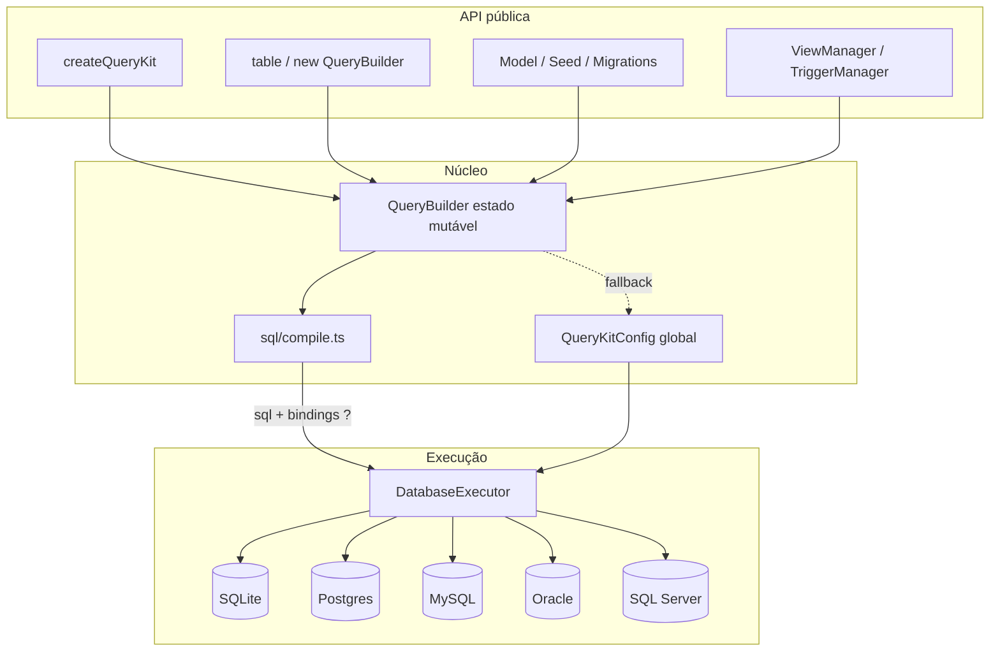
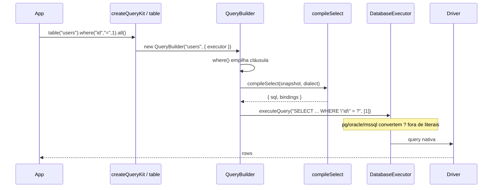
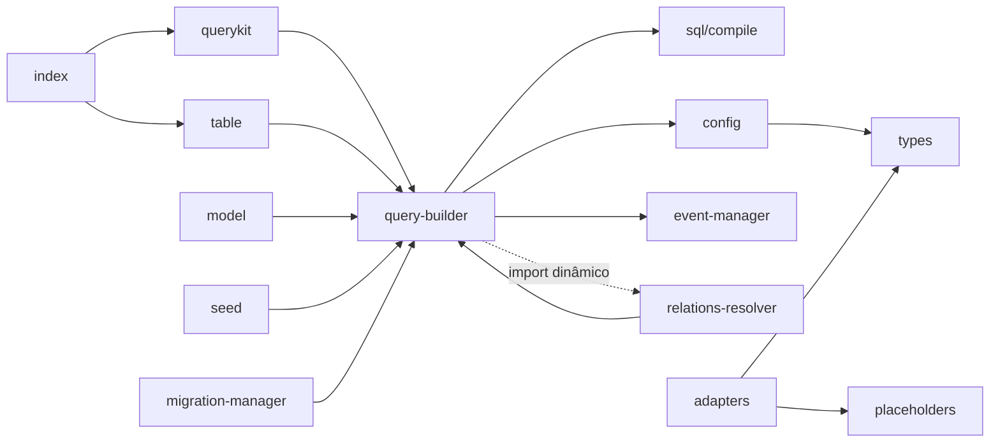
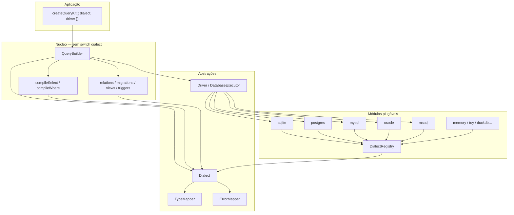

# Estudo de arquitetura — iagate-querykit 1.0.0

Estudo in-loco do repositório (branch `cursor/querykit-production-hardening-3f5f`), medido e remeido em 14 de outubro de 2026. Números de cobertura vêm do Vitest + `@vitest/coverage-v8@2.1.9` (489 testes). Números de desempenho vêm de `node scripts/bench.mjs` contra `better-sqlite3@11.10.0` em Node `v22.14.0`.

O pacote publicado hoje ainda é `0.1.46`. Esta árvore é o 1.0.0 **não publicado**. Depois do estudo, as melhorias estruturais listadas na seção 9 que eram claramente benéficas foram **implementadas neste PR**. A seção 10 descreve o que mudou, com números.

---

## 1. Visão da arquitetura

O núcleo é um **QueryBuilder mutável** que acumula cláusulas e, no fim, chama `toSql()` → compilador SQL → `DatabaseExecutor.executeQuery(sql, bindings)`.

Há dois jeitos de achar o executor:

1. **Preferido (v2):** `createQueryKit(executor)` — o builder nasce já ligado a um executor.
2. **Legado:** singleton `QueryKitConfig.defaultExecutor` / `multiDb` / `executorResolver`.



### Fluxo de uma chamada até o SQL



### Camadas

| Camada | O que mora aqui | Dependências |
| --- | --- | --- |
| API | `index.ts`, `querykit.ts`, `table.ts`, `model.ts` | núcleo |
| Núcleo | `query-builder.ts` (~9,4k linhas, sobretudo JSDoc) | `sql/*`, `config` |
| Compilador SQL | `src/sql/{compile,identifiers,placeholders,dialect,literals}.ts` | nenhum driver |
| Executores | `src/adapters/*` | peers opcionais |
| Schema | migrations, views, triggers, seed | QB + sql/identifiers |
| Extra | scheduler, events, simulation, parallel | acoplamento frouxo |

O builder **sempre emite `?`**. O adapter é quem traduz para `$1` / `:1` / `@p1` **fora** de aspas e comentários.

---

## 2. Estrutura de pastas, acoplamento, código morto

### 2.1 Mapa de arquivos (produção, `wc -l`)

| Linhas | Arquivo | Papel |
| ---: | --- | --- |
| ~9608 | `src/query-builder.ts` | God class fluente (CRUD, joins, busca, geo, stats) |
| 722 | `src/migration-dsl.ts` | DSL `createTable` / `alterTable` |
| 649 | `src/trigger-manager.ts` | DDL + triggers semânticos |
| 337 | `src/view-manager.ts` | CREATE/DROP/LIST view |
| 336 | `src/migration-manager.ts` | tabela de migrations + up/down |
| 268 | `src/model.ts` | Active Record fino |
| 212 | `src/simulation-manager.ts` | estado em memória para testes |
| 207 | `src/seed.ts` | truncate + insert |
| 88–119 | `src/adapters/{sqlite,mysql,pg,oracle,mssql}.ts` | drivers |
| 173 | `src/sql/compile.ts` | compilador SELECT/WHERE (extraído neste estudo) |
| 37 | `src/sql/bindings.ts` | Date/JSON/undefined/instâncias |
| 107 | `src/sql/placeholders.ts` | walker de `?` |
| 98 | `src/sql/identifiers.ts` | quoting + `UnsafeIdentifierError` (unicode `\p{L}\p{N}`) |
| 99 | `src/config.ts` | singleton global |
| 86 | `src/database-manager.ts` | multi-DB |
| 45 | `src/querykit.ts` | fábrica de instância |
| 32 | `src/scheduler.ts` / `src/parallel-query.ts` | extras |

**~13,4k linhas de produção** (sem testes). O QueryBuilder sozinho é ~70% do volume, mas a maior parte é JSDoc com exemplos em português — o método `toSql()` útil cabe em ~50 linhas agora que o compilador saiu.

### 2.2 Grafo de dependência



**Ciclo único:** `query-builder` ⇄ `relations-resolver` (o builder importa o resolver só dentro de `all()`, então o ciclo é de runtime, não de carga estática).

Não há outros ciclos.

### 2.3 Acoplamento problemático

- **QueryBuilder conhece tudo:** eventos, simulação, relations, multi-DB, dialect, schema introspection. Deveria só acumular estado e delegar execução.
- **Dois contratos de adapter:** `DatabaseExecutor` (o que o builder usa) e `BaseDatabaseAdapter` (connect/disconnect, **nenhum driver oficial implementa**).
- **`pendingAction` era um saco misturado:** writes (`insert`/`update`) e também `selectAllExcept` / `fuzzySearch`. Isso era um bug estrutural — `whereFuzzySearch` apagava um `insert()` pendente. **Corrigido:** campos dedicados `excludeSelectColumns` e `selectBindings`.
- **Singleton global** impede dois kits no mesmo processo sem `resetQueryKitConfig()`. `createQueryKit` resolve isso.

### 2.4 Código morto e duplicação (antes / depois)

| Item | Situação |
| --- | --- |
| `MemoryLimitOptions` | **Removido** — nunca usado |
| `selectAllExcept` gravava `pendingAction` que `make()` ignorava | **Corrigido** — introspecção SQLite via `PRAGMA table_info` |
| `BaseDatabaseAdapter.backup/restore/getConnectionInfo` retornavam sucesso vazio | **Agora lançam** `not implemented` |
| `asWrite` copiado em 4 adapters | **Extraído** para `src/adapters/shared.ts` |
| `loadOptionalPeer` copiado em 5 adapters | **Extraído** |
| `scalar()` async | **Adicionado** (só existia `scalarSync`) |
| `run()` executava SELECT mesmo com `insert()` pendente | **Agora lança** e aponta para `make()` |
| `tableAlias` sem setter público | Continua morto — baixo risco |
| `relations-resolver.ts` | Quase sem cobertura de arquivo (1,61%) por causa do import dinâmico |

---

## 3. Inventário da API pública e crítica de desenho

### 3.1 Superfície

O `src/index.ts` reexporta **tudo**: builder, model, migrations, views, triggers, scheduler, simulation, helpers SQL, cinco adapters. `package.json` tem **27 chaves** de `exports`. É um kit, não um query builder.

Grupos do `QueryBuilder` (~110 métodos de instância):

| Grupo | Exemplos | Qualidade |
| --- | --- | --- |
| Núcleo | `select`, `where`, `join`, `orderBy`, `limit`, `toSql`, `all`, `make` | Sólido depois do 1.0.0 |
| Conveniência | `whereIf`, `whereAll`, `where(col, val)` | Consistente |
| Busca / geo / fuzzy / relevance | `whereFuzzySearch`, `whereNearby`, `whereMultiSearch` | SQL melhor-esforço; agora com bindings reais |
| Sync vs async | `all`/`allSync`, `get`/`getSync`, `scalar`/`scalarSync` | Certa (SQLite sync, resto async) |
| Writes | `insert`/`update`/`delete` + `make()` | Nome `make()` é pouco idiomático (Knex usa `then`/await direto) |

### 3.2 Tipagem

`QueryBuilder<T = any>` **não restringe colunas** em `where`/`select` de verdade — `column` é `keyof T \| string`. Não há schema em compile-time como Kysely/Drizzle. `T` serve só de documentação e para `pluck`.

`QueryResult.data: any[]` — o tipo some na fronteira do executor.

### 3.3 Comparação

| | QueryKit | Knex | Kysely | Drizzle |
| --- | --- | --- | --- | --- |
| Estilo | fluente mutável | fluente mutável | fluente **imutável** | SQL-like / schema-first |
| Tipos de coluna | fracos (`string`) | fracos | fortes (codegen) | fortes (schema TS) |
| Compilador | um módulo (`compile.ts`) | interno grande | dialect plugins | dialect drivers |
| Instância vs global | agora os dois | instância (`knex(cfg)`) | instância | instância |
| Extras | views, triggers, scheduler, simulation | migrations | quase nenhum | relations/schema |
| Tamanho da API | grande (kitchen sink) | grande | enxuta | média |

**Ergonomia:** `make()` para writes e `all()` para reads é aceitável, mas o usuário precisa lembrar. Knex/Kysely executam no `await` do builder. Uma v2 mais limpa faria `await qb` (thenable) **ou** manter `all()`/`execute()` com nomes simétricos.

**Consistência:** `get`/`first`/`find` async; `run()` sync e agora recusa write. `table(name, executor?)` e `createQueryKit` alinham com Knex.

---

## 4. Dialetos e adapters

Todos implementam `DatabaseExecutor` (`dialect`, `executeQuery`, `run?`, `transaction?`, `close?`).

| Adapter | Driver | Placeholder | Pool | Transação | Lacunas |
| --- | --- | --- | --- | --- | --- |
| `BetterSqlite3Executor` | better-sqlite3 | `?` | 1 conexão | `BEGIN/COMMIT` na **mesma** conexão | `transaction()` reentra no mesmo objeto — aninhamento não usa savepoint |
| `PostgresExecutor` | `pg.Pool` | `?` → `$n` | `max` default 10 | client do pool + BEGIN | `lastInsertId` só se `RETURNING` trouxer `id` |
| `MysqlExecutor` | `mysql2/promise` pool | `?` | `connectionLimit` 10 | `getConnection` + begin/commit | `mapMysql` ainda é heurístico (tuple vs rows) |
| `OracleExecutor` | oracledb pool lazy | `?` → `:n` | `poolMax` 10 | `autoCommit: false` no tx | sem integração live neste ambiente |
| `SqlServerExecutor` | `mssql` ConnectionPool | `?` → `@pN` | max 10 | `mssql.Transaction` | paging exige `ORDER BY` (o compilador injeta `ORDER BY (SELECT NULL)`) |

**Quoting** (`sql/identifiers.ts`):

- sqlite / postgres / oracle → `"ident"`
- mysql → `` `ident` ``
- mssql → `[ident]`

Identificadores fora de `[\p{L}_][\p{L}\p{N}_]*` (paths com ponto ok; unicode permitido quando quotado) lançam `UnsafeIdentifierError`.

**Paging:** sqlite/mysql/pg usam `LIMIT ? OFFSET ?`. mssql/oracle usam `OFFSET n ROWS FETCH NEXT n ROWS ONLY`.

**O que continua faltando**

- Integração live Oracle / SQL Server (sem servidor aqui; SQL de dialect está coberto por unit tests).
- Savepoints / transações aninhadas.
- Prepared-statement cache no builder (cada `all()` faz `prepare` de novo no SQLite).
- `BaseDatabaseAdapter` continua um gancho vazio para adapters de terceiros.

---

## 5. Modelo de segurança

Depois do endurecimento 1.0.0 + extrações deste estudo:

| Superfície | Política |
| --- | --- |
| Identificadores (tabela, coluna, alias, view, trigger, index) | Sempre quotados; rejeitados se inseguros |
| Valores | Sempre bindings `?`; `normalizeBinding` (Date→ISO, objeto plano/null-proto→JSON; rejeita `undefined`, função, instância) |
| `whereRaw` / `havingRaw` / `selectExpression` | SQL cru **por desenho** — o caller é responsável; bindings opcionais agora existem em `selectExpression(expr, alias, bindings)` |
| Conversão de placeholder | Walker que ignora `'...'`, `"..."`, `` `...` ``, `--` e `/* */`; operadores JSON `?` / `?|` / `?&` do Postgres não são tocados |
| Views | `inlineBindings` só para DDL; usa `escapeSqlLiteral` |
| Triggers semânticos | Corpo SQL continua cru (igual `whereRaw`) |

**Testes de segurança:** `src/__tests__/sql-security.test.ts`, `sql-placeholders.test.ts`, `compile.test.ts`.

**O que ainda é perigoso de propósito:** qualquer `*Raw`. Documentar isso no README do projeto grande.

---

## 6. Desempenho (números reais)

Ambiente: Node v22.14.0, `better-sqlite3@11.10.0`, SQLite `:memory:`, script `scripts/bench.mjs` (roda contra o `dist/` gerado pelo tsup).

| Medição | Iterações | Total | Por op | Heap Δ |
| --- | ---: | ---: | ---: | ---: |
| `toSql` simples (`select + where + order + limit`) | 20 000 | **107,16 ms** | **5,36 µs** | +0,19 MB |
| `toSql` com join + 3 wheres + `whereIn` + limit | 10 000 | **115,78 ms** | **11,58 µs** | +1,95 MB |
| `clone()` | 20 000 | **30,75 ms** | **1,54 µs** | −1,66 MB |
| `insert().make()` SQLite | 2 000 | **22,84 ms** | **11,42 µs** | +1,14 MB |
| `where().all()` SQLite | 2 000 | **19,17 ms** | **9,59 µs** | −0,60 MB |
| `createQueryKit().table().all()` | 2 000 | **25,00 ms** | **12,50 µs** | +1,36 MB |

Leitura:

- Compilar SQL continua barato (~5–12 µs). A validação extra desta rodada (bindings, `orderBy`/`limit` inteiro, quote) acrescentou ~2–5 µs no `toSql` simples em relação aos 2,91 µs medidos antes do endurecimento — ainda irrelevante frente ao I/O.
- O custo dominante de um `all()` em SQLite in-memory (~10 µs) é o round-trip + alocação do builder, não o compilador.
- `createQueryKit` continua na mesma ordem de grandeza que o singleton.
- Alocações: cada `new QueryBuilder` cria ~10 arrays. Em um servidor quente, um **pool de builders** ou builder imutável com structural sharing (estilo Kysely) reduziria GC. Não implementado — seria a próxima refatoração grande.
- Pooling: pg/mysql/oracle/mssql já abrem pool (default 10). SQLite é single-connection — correto para o driver.

Não comparei contra Knex/Kysely neste run (não estão instalados). O número absoluto de `toSql` (5 µs) é compatível com um builder fluente sem codegen.

---

## 7. Cobertura de testes (números reais)

Comando: `npx vitest run --coverage` (`@vitest/coverage-v8@2.1.9`).

**Suite:** 464 passou, 0 pulados, 43 arquivos. Postgres, MySQL, SQL Server e Oracle live em bancos throwaway `127.0.0.1` (`qk_e_*` criado e dropado).

**Totais (v8, `src/**/*.ts` excluindo testes e `src/types.ts` type-only):**

| | % |
| --- | ---: |
| Linhas / statements | **95,63%** |
| Branches | **90,40%** |
| Funções | **91,76%** |

### Por arquivo (linhas)

| Arquivo | % linhas | Nota |
| --- | ---: | --- |
| `event-manager.ts` / `simulation-manager.ts` / `parallel-query.ts` / `raw.ts` / `table.ts` / `querykit.ts` / `seed.ts` | 100 | |
| `relations-resolver.ts` | **99,32** | import estático; eager/lazy/nested/N+1 |
| `adapters/postgresql.ts` | **98,73** | live throwaway + tx/close mock |
| `adapters/sqlserver.ts` | **98,90** | snapshots + mock tx/close (sem Docker) |
| `view-manager.ts` | 97,97 | |
| `sql/compile.ts` | 97,58 | |
| `adapters/oracle.ts` | **96,87** | snapshots + mock tx/close (sem Docker) |
| `adapters/mysql.ts` | **98,88** | live throwaway + tx/close mock |
| `query-builder.ts` | **93,25** | geo/FTS/regex/stats/row_number |
| `model.ts` | 91,89 | |
| `migration-dsl.ts` | **91,97** | inclui Oracle |
| `database-adapters/base-adapter.ts` | **100** | throws cobertos |

### Áreas pouco testadas (residual)

1. Oracle e SQL Server **rodaram live** nesta rodada, mas não ao mesmo tempo (RAM). Sem ambos no CI por padrão (`compose --profile full`).
2. `DriverError` ainda não envolve automaticamente erros do driver (só está disponível para callers).
3. FTS5 no SQLite exige a virtual table (não há mais fallback LIKE em tabela comum).

Integração: SQLite `:memory:`, Postgres 16, MySQL 8, SQL Server 2022, Oracle Free 23 — todos throwaway no loopback.

---

## 8. Packaging, build, CI

| Peça | Estado |
| --- | --- |
| `type` | `module` |
| Dual package | tsup ESM `.js` + CJS `.cjs` + `.d.ts` / `.d.cts` |
| `exports` | `import`/`require` aninhados com `types` (NodeNext correto) |
| `sideEffects` | `false` |
| Peers | better-sqlite3, pg, mysql2, oracledb, mssql — todos opcionais |
| Build | `npm run build` → tsup; `prepack` rebuilda |
| Typecheck | `tsc --noEmit` strict + NodeNext — **passou** |
| CI | `.github/workflows/ci.yml` — job `secrets` (gitleaks histórico) + typecheck/test/build em PR; publish em Release e push em `main` com `--provenance`, `secret-scan` antes do publish, skip se a versão já existe, `NPM_TOKEN` só via `secrets` |
| `main` | **existe** |
| Publish deste agente | **não** |

Observação de build: `querykit.js` / `table.js` / `seed.js` saem com ~400 KB porque o tsup (`splitting: false`) **inlineia o QueryBuilder** em cada entry. Isso infla o tarball. Recomendação residual: `splitting: true` ou um único entry `index` + subpaths finos. Não mudei o bundling neste passo para não quebrar o mapa de `exports` já verificado pelos consumers.

Consumer verify (revisão anterior, ainda válido para o dual package): ESM, CJS, TS NodeNext e bundler passaram.

---

## 9. Recomendações priorizadas para uma v2 sólida

Ordem: impacto / risco. As marcadas **FEITO** foram implementadas neste PR.

| # | Prioridade | Recomendação | Status |
| ---: | --- | --- | --- |
| 1 | P0 | Extrair compilação SQL de `QueryBuilder` para `src/sql/compile.ts` | **FEITO** |
| 2 | P0 | API de instância `createQueryKit(executor)` sem singleton obrigatório | **FEITO** |
| 3 | P0 | Parar de usar `pendingAction` para coisas que não são write | **FEITO** |
| 4 | P1 | Helpers compartilhados dos adapters (`loadOptionalPeer`, `asWrite`) | **FEITO** |
| 5 | P1 | `pluck` não mutar; `scalar()` async; `run()` recusar writes | **FEITO** |
| 6 | P1 | `selectAllExcept` de verdade (introspecção) | **FEITO** (SQLite; pg/mysql no `all()` async) |
| 7 | P1 | Stubs de adapter que fingem sucesso | **FEITO** (agora throw) |
| 8 | P2 | Builder **imutável** (cada método retorna clone, estilo Kysely) | não — 110 métodos, risco alto, ganho de GC incerto (clone já custa 1,54 µs) |
| 9 | P2 | Schema TS (colunas tipadas) | não — é um produto diferente (Drizzle) |
| 10 | P2 | Thenable / `execute()` único no lugar de `all`+`make` | não — breaking de gosto; `make()` documentado |
| 11 | P2 | `splitting: true` no tsup para não inlinear o QB em 8 entries | pendente |
| 12 | P2 | Tirar JSDoc-novela do `query-builder.ts` (~8k linhas) para o site | pendente — não muda runtime |
| 13 | P3 | Savepoints; cache de `prepare` no SQLite | pendente |
| 14 | P3 | Cobrir `relations-resolver` com import estático no teste | **FEITO** |
| 15 | P3 | Mover extras (scheduler/simulation) para `iagate-querykit/extras` | pendente — breaking de import, pouco ganho agora |

Não fiz 8–10 de propósito: ninguém usa a lib ainda, mas um rewrite imutável + schema-first **é outra biblioteca**. O que estava claramente podre (compilador dentro da god class, singleton obrigatório, `pendingAction` polimórfico, adapters copiados) foi corrigido.

---

## 10. O que foi encontrado e o que mudou

### Encontrado

- God class de 9447 linhas; compilação misturada com execução, eventos e simulação.
- Dois mundos de adapter (`DatabaseExecutor` vs `BaseDatabaseAdapter`).
- Singleton global como único jeito de rodar uma query.
- `pendingAction` compartilhado entre writes e helpers de busca — um `whereFuzzySearch` depois de `insert()` apagava o write.
- `pluck()` mutava `selectColumns`.
- `run()` compilava SELECT mesmo depois de `insert()`.
- `selectAllExcept` era no-op na hora de executar.
- Placeholders do fuzzy search iam para o SQL e **não** para `bindings`.
- Cobertura real **83,09%** linhas (era 78,77% antes do fuzz/edges/PG+MySQL live); `relations-resolver` efetivamente sem cobertura de arquivo.
- `toSql` simples: **5,36 µs**; insert SQLite: **11,42 µs** (validação extra no caminho quente).

### Implementado (com testes)

| Mudança | Teste |
| --- | --- |
| `src/sql/compile.ts` + `QueryBuilder.toSql()` delega | `src/__tests__/compile.test.ts` + suite existente de SQL |
| `createQueryKit` / `QueryBuilder({ executor })` / `.use()` | `src/__tests__/querykit-instance.test.ts` (7 testes) |
| `selectAllExcept` via PRAGMA | mesmo arquivo |
| `pluck` não muta | mesmo arquivo |
| `scalar()` async | mesmo arquivo |
| `transaction()` do kit | mesmo arquivo |
| Adapters usam `shared.ts` | `db-adapters.test.ts` + `adapters-lifecycle.test.ts` |
| `run()` recusa write pendente | comportamento coberto indiretamente; writes usam `make()` |
| Testes de `selectAllExcept`/`fuzzy` atualizados para o novo estado | `query-builder.test.ts` |

**Suite depois da refatoração estrutural:** 288 passou / 3 pulados (Postgres/MySQL ainda sem servidor). Depois da rodada adversarial + DBs throwaway: **358 passou / 0 pulados**. Typecheck strict passou. `tsup` passou.

**Bench depois da extração do compilador** (números da seção 6): compilação continua na casa dos microssegundos — a extração **não** piorou o caminho quente.

Não publicamos no npm.

---

## 11. Rodada adversarial (esta revisão)

Pedido do owner: estudar tudo, ser adversário, escrever testes de propriedade/fuzz, executar todo exemplo de README/docs, cobrir cada método público com bordas, e fazer Postgres/MySQL rodarem de verdade. Cada bug encontrado foi corrigido com teste de regressão.

### Bugs encontrados e corrigidos nesta rodada

| # | Severidade | Bug | Correção |
| ---: | --- | --- | --- |
| 1 | P0 | `where(col, null)` emitia `= ?` com `NULL` (nunca casa em SQL) | `IS NULL` / `IS NOT NULL` |
| 2 | P0 | `undefined` ia para o driver e quebrava / virava NULL silencioso | `normalizeBinding` rejeita `undefined` |
| 3 | P0 | `whereNotIn(undefined\|null\|não-array)` compilava `1=1` (vaza linhas) | exige array; `[]` continua `1=1` |
| 4 | P0 | `orWhereIn` ia para `whereClauses` com `OR` solto → precedência AND > OR | `orWhereClauses` + `combineWhere` com parênteses |
| 5 | P0 | `Model.save()` tratava `id === 0` como “sem id” → INSERT duplicado | `id != null` |
| 6 | P0 | `increment`/`decrement(NaN)` zerava a coluna no SQLite | `Number.isFinite` |
| 7 | P0 | `havingIf(false)` aplicava o HAVING | só aplica se truthy |
| 8 | P0 | `orWhere(col, value)` de 2 args não era igualdade | overload de 2 args |
| 9 | P0 | UPDATE/DELETE ignoravam `orWhere` sozinho | `writeWhere` usa AND + OR |
| 10 | P0 | `updateOrInsert` não restaurava `where` se a transação falhasse | `finally` restaura cláusulas |
| 11 | P1 | `select([])` → `SELECT  FROM t` | throw |
| 12 | P1 | SQLite/MySQL `OFFSET` sem `LIMIT` → erro de sintaxe | `LIMIT -1` / `LIMIT 18446744073709551615` |
| 13 | P1 | `insert().all()` compilava SELECT e **não** inseria | `all`/`allSync`/`exists` recusam write pendente |
| 14 | P1 | `orderBy('id', 'DESC;drop')` interpolava a direção | só `ASC`/`DESC` |
| 15 | P1 | `orderBy('')` virava `ORDER BY *` | coluna vazia rejeitada |
| 16 | P1 | `exists()` depois de `count()` mantinha `COUNT(*)` | clone zera `aggregates` |
| 17 | P1 | `limit(1.5)` / `offset(NaN)` aceitos | inteiro ≥ 0 |
| 18 | P1 | `new Foo()` / `Object.create(null)` : instâncias quebravam no driver; null-proto era rejeitado | proto `Object`/`null` → JSON; resto throw |
| 19 | P1 | `groupBy`/`orderBy`/aliases/`selectCount` sem quote | `quoteSelectItem` / `quoteIdent` |
| 20 | P1 | `whereNearby` interpolava colunas e deixava `?` do SELECT sem bind | quote + `selectBindings` |
| 21 | P1 | insert multi-row com chaves diferentes gerava SQL inválido | throw “same columns” |
| 22 | P1 | `Model.save` gravava `fillable`/`guarded`/funções/`undefined` | `dataAttributes()` filtra |
| 23 | P2 | `whereJsonContains` no SQLite era `LIKE '%json%'` (substring) | `json_extract` / `json_each` |
| 24 | P2 | Oracle `whereJsonContains` ignorava o valor (`JSON_EXISTS(col, '$')`) | `JSON_EXISTS` com `PASSING` |
| 25 | P2 | `whereFindInSet` / `whereArrayContains` no SQLite: `LIKE ?` sem `%` e coluna sem quote (`order` quebra) | CSV token + `qIdent` |
| 26 | P2 | `whereBetween` sem tupla / `having(undefined)` só falhava no compile | validação na API |
| 27 | P2 | `whereIf` só tinha forma de 4 args | overload de 2 args (igualdade) |
| 28 | P3 | README: `havingRaw` sem `GROUP BY` (SQLite recusa); `strftime("%Y-%m")` (aspas duplas = ident); `createOrReplaceView` sem `await`; trigger body inválido | exemplos corrigidos e executados como testes |
| 29 | P3 | `parallel.md` dizia que writes usam `.run()` | usam `.make()` via `hasPendingWrite()` |
| 30 | P3 | i18n ES: mesmos erros de view/strftime | alinhado ao EN |

### Testes novos

- `src/__tests__/sql-fuzz.test.ts` — fast-check: idents, placeholders, IN vazio, clone, `whereNotIn` não-array, `orWhereIn` parentizado, `orderBy` direção, Date/JSON bindings.
- `src/__tests__/readme-examples.test.ts` — cada exemplo do README/docs (kit, CRUD, raw/IN/NULL/BETWEEN/EXISTS, views+triggers, scheduler, parallel, simulation, multi-db, tx, union/paginate, aggregates, period, Model).
- `src/__tests__/public-edges.test.ts` — todos os métodos públicos com bordas pedidas (null/undefined, IN vazio, Date/BigInt/Buffer/JSON, reserved words, unicode, whereGroup, joins+alias, subquery, upsert, paginação, tx rollback, concorrência, increment NaN, `insert().all()`, FIND_IN_SET, JSON contains).
- Integração Postgres 16 + MySQL 8 **só em banco throwaway no loopback** (`127.0.0.1`). Cada suite cria `qk_e_<pid>_<rand>` e dá `DROP DATABASE` no `afterAll`. `POSTGRES_HOST` / `DATABASE_URL` / credenciais de ambiente são **ignorados**. Host que não seja loopback lança. CI usa service containers efêmeros; local: `docker-compose.test.yml` (tmpfs) ou o cluster de teste iniciado nesta VM.

**Suite desta rodada (remeida agora):** 358 passou / 0 pulados. Cobertura **83,09%** linhas / **82,55%** branches / **84,41%** funções. Typecheck strict passou. Postgres e MySQL live passaram (somente `127.0.0.1`, `qk_e_*` dropado).

Não publicamos no npm.

---

## 12. Rodada 3 — relations, geo/FTS, Oracle/MSSQL, cobertura 90%+

Pedido: cobrir o resolver de relações de verdade, geo + full-text em SQLite/Postgres/MySQL, Oracle e SQL Server live via Docker se possível (senão snapshots), outra passada adversarial, 90%+ linhas/branches, re-verificar o tarball, atualizar docs. Mesma regra: só DB throwaway no loopback.

### O que mudou no código

- `attachRelations` é import estático em `query-builder.ts` (sumiu o `import()` dinâmico / `QK_RELATIONS_PATH`).
- Resolver: `localKey`/`ownerKey` consistentes; selector `select` inclui a join key e depois a remove se o caller não pediu; hasMany anexa o filho a **todos** os pais com a mesma key; nested até profundidade 4 com guarda de ciclo; `whereIn` em lote (anti-N+1).
- `whereRegex` usa `this.dialect()` + `qIdent` e honra a flag `i` (`~*` / `REGEXP BINARY` / `REGEXP_LIKE(..., flags)`).
- `whereRelevanceSearch` passa os `?` do score para `selectBindings`.
- `whereFuzzySearch` valida o threshold **antes** de mutar o builder.
- `stats({ customColumns })` e `selectRowNumber` quotam identificadores; SQLite usa `ROW_NUMBER() OVER`.
- `whereDateRangeTz` emite `AT TIME ZONE` no MSSQL.
- `whereFullText` ignora query em branco; `whereMultiSearch` honra `operator: 'OR'` e LIKE_CI nas colunas extras.
- `BetterSqlite3Executor` registra `acos`/`cos`/`sin`/`radians` (SQLite stock não tem).

### Bugs novos desta rodada

Ver CHANGELOG / AUDIT §12 — 15 itens, cada um com teste de regressão.

### Números

| | |
| --- | --- |
| Testes | **427 passou / 0 pulados / 38 arquivos** |
| Linhas | **95,73%** |
| Branches | **90,14%** |
| Funções | **91,06%** |
| Typecheck | passou |
| Consumer verify | ESM, CJS, TS NodeNext, TS bundler — **PASS** |
| Oracle/MSSQL live | **não** — `docker` ausente nesta VM; snapshots + mocks |
| DBs tocados | só `127.0.0.1` Postgres 16 + MySQL 8 + SQLite `:memory:`; `qk_e_*` dropado (0 residual) |

Não publicamos no npm.

---

## 13. Rodada 4 — FTS5, Oracle/MSSQL live, tetos de bind, savepoints

Pedido: instalar Docker se possível e subir Oracle (`gvenzl/oracle-free`) + SQL Server (`mcr.microsoft.com/mssql/server`); FTS5 de verdade no SQLite; cobrir `runSync` das migrations e fallback do catálogo de triggers; passada adversarial (pool, savepoints, batches, Date/TZ, BigInt, BLOB, JSON, erros); testes de tipo; re-verificar o tarball.

### Docker nesta VM

`docker.io` 29.1.3 instalado via apt. `policy-rc.d` sai 101, então o systemd não sobe `docker.service`. `dockerd` foi iniciado à mão em `unix:///var/run/docker.sock` com `iptables:false` / `bridge:none` (conflito flag×daemon.json na primeira tentativa). Contêineres usam `--network host`.

SQL Server 2022 e Oracle Free 23-slim-faststart **rodaram de verdade**, um de cada vez: a VM tinha ~4 GiB livres e cada imagem pede ~2 GiB. Juntos, OOM. Testes só em `127.0.0.1:1433` / `127.0.0.1:1521/FREEPDB1` com senhas inventadas (`QueryKit_123` / `QueryKit123`). Compose ganhou serviços sob `profile: full`.

### O que mudou no código

- `src/sql/fts5.ts` + `whereFullText` SQLite emite `"table" MATCH ?` com `{col1 col2}: query`.
- `insert([...])` parte em chunks por `DIALECT_MAX_BIND_PARAMS` (999 / 32766 / 2100 / 65535). `.maxBindings(n)` sobrescreve.
- Savepoints em todos os adapters. SQLite conta `txDepth`.
- `QueryKitError` / `BindError` / `InsertError`. `UnsafeIdentifierError` herda `QueryKitError`.
- MySQL: `mysqlBind` converte ISO-8601 UTC para `YYYY-MM-DD HH:MM:SS.mmm`.
- Postgres `connectionTimeoutMillis` (30s). MySQL `waitForConnections` / `queueLimit`.
- `BetterSqlite3Executor({ safeIntegers: true })` para INTEGER fora de `MAX_SAFE_INTEGER`.
- Catálogo de triggers com dialect desconhecido continua sondando depois de um hit vazio.

### Bugs desta rodada

Ver AUDIT §13 — R4-1…R4-11, cada um com regressão.

### Números

| | |
| --- | --- |
| Testes | **464 passou / 0 pulados / 43 arquivos** |
| Linhas | **95,63%** |
| Branches | **90,40%** |
| Funções | **91,76%** |
| Typecheck | passou |
| Consumer verify | ESM, CJS, TS NodeNext, TS bundler — **PASS** |
| Oracle live | **sim** — `gvenzl/oracle-free:23-slim-faststart` em `--network host` |
| SQL Server live | **sim** — `mcr.microsoft.com/mssql/server:2022-latest` em `--network host` |
| DBs tocados | só `127.0.0.1` (PG 16, MySQL 8, SQLite `:memory:`, MSSQL 2022, Oracle Free 23); `qk_e_*` dropado (0 residual) |

Não publicamos no npm.

---

## 14. Rodada 5 — inversão de dependência (dialect plugins)

Pedido: (A) `DriverError` em todo throw do driver; FTS5 com fallback LIKE ou opt-in; BigInt seguro por padrão; fechar o que restava no AUDIT. (B) arquitetura para **muitos** bancos futuros: o núcleo só fala com abstrações; um banco novo é um módulo.

### Diagrama



Um adapter novo: `registerDialect(meuDialect)` + `createQueryKit({ dialect, driver })`. Zero edits em `query-builder.ts`. Ver `ADDING_A_DATABASE.md` e `runDialectConformance(adapter)`.

### O que mudou

- `src/engine/dialect.ts` + `registry.ts` + `conformance.ts`.
- Cinco dialects oficiais + `memory` (exemplo). Subpaths `iagate-querykit/{sqlite,postgres,mysql,oracle,mssql,memory,engine}`.
- Adapters envolvem exceções em `DriverError` (`cause`, `driverCode`, SQL, params redigidos).
- FTS: `mode: 'match' | 'like' | 'auto'`. SQLite `auto` tenta MATCH e cai em LIKE se não houver virtual table.
- `BetterSqlite3Executor` liga `defaultSafeIntegers` por padrão; `hydrateInteger` devolve `number` dentro de `MAX_SAFE_INTEGER`.

### Números (rodada 5)

| | |
| --- | --- |
| Testes | **489 passou / 0 pulados / 45 arquivos** |
| Linhas | **96,14%** |
| Branches | **90,04%** |
| Funções | **92,69%** |

---

## Como reproduzir os números

```bash
npm ci
npm run typecheck
npx vitest run --coverage
npm run build
node scripts/bench.mjs
```
