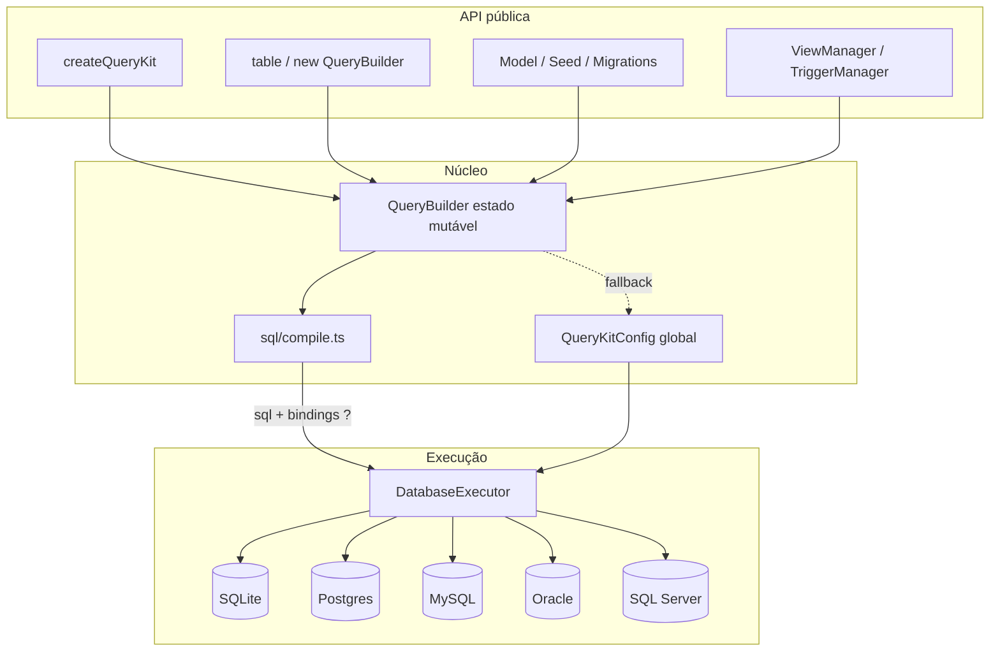
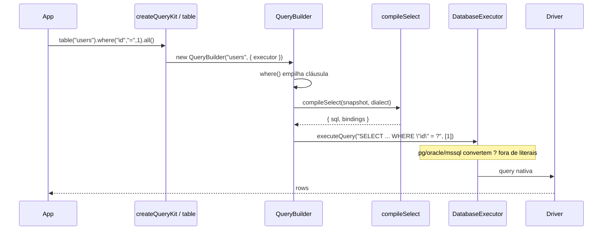
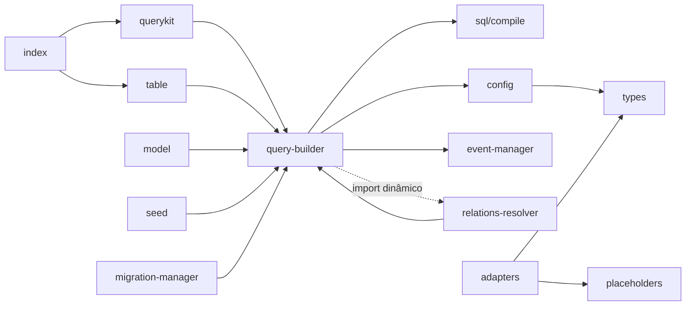

# Estudo de arquitetura — iagate-querykit 1.0.0

Estudo in-loco do repositório (branch `cursor/querykit-production-hardening-3f5f`), medido em 14 de outubro de 2026. Números de cobertura vêm do Vitest + `@vitest/coverage-v8@2.1.9`. Números de desempenho vêm de `node scripts/bench.mjs` contra `better-sqlite3@11.10.0` em Node `v22.14.0`.

O pacote publicado hoje ainda é `0.1.46`. Esta árvore é o 1.0.0 **não publicado**. Depois do estudo, as melhorias estruturais listadas na seção 9 que eram claramente benéficas foram **implementadas neste PR**. A seção 10 descreve o que mudou, com números.

---

## 1. Visão da arquitetura

O núcleo é um **QueryBuilder mutável** que acumula cláusulas e, no fim, chama `toSql()` → compilador SQL → `DatabaseExecutor.executeQuery(sql, bindings)`.

Há dois jeitos de achar o executor:

1. **Preferido (v2):** `createQueryKit(executor)` — o builder nasce já ligado a um executor.
2. **Legado:** singleton `QueryKitConfig.defaultExecutor` / `multiDb` / `executorResolver`.



### Fluxo de uma chamada até o SQL



### Camadas

| Camada | O que mora aqui | Dependências |
| --- | --- | --- |
| API | `index.ts`, `querykit.ts`, `table.ts`, `model.ts` | núcleo |
| Núcleo | `query-builder.ts` (~9,4k linhas, sobretudo JSDoc) | `sql/*`, `config` |
| Compilador SQL | `src/sql/{compile,identifiers,placeholders,dialect,literals}.ts` | nenhum driver |
| Executores | `src/adapters/*` | peers opcionais |
| Schema | migrations, views, triggers, seed | QB + sql/identifiers |
| Extra | scheduler, events, simulation, parallel | acoplamento frouxo |

O builder **sempre emite `?`**. O adapter é quem traduz para `$1` / `:1` / `@p1` **fora** de aspas e comentários.

---

## 2. Estrutura de pastas, acoplamento, código morto

### 2.1 Mapa de arquivos (produção, `wc -l`)

| Linhas | Arquivo | Papel |
| ---: | --- | --- |
| ~9447 | `src/query-builder.ts` | God class fluente (CRUD, joins, busca, geo, stats) |
| 722 | `src/migration-dsl.ts` | DSL `createTable` / `alterTable` |
| 649 | `src/trigger-manager.ts` | DDL + triggers semânticos |
| 337 | `src/view-manager.ts` | CREATE/DROP/LIST view |
| 336 | `src/migration-manager.ts` | tabela de migrations + up/down |
| 268 | `src/model.ts` | Active Record fino |
| 212 | `src/simulation-manager.ts` | estado em memória para testes |
| 207 | `src/seed.ts` | truncate + insert |
| 95–136 | `src/adapters/{sqlite,mysql,pg,oracle,mssql}.ts` | drivers |
| 170 | `src/sql/compile.ts` | compilador SELECT/WHERE (extraído neste estudo) |
| 107 | `src/sql/placeholders.ts` | walker de `?` |
| 97 | `src/sql/identifiers.ts` | quoting + `UnsafeIdentifierError` |
| 99 | `src/config.ts` | singleton global |
| 86 | `src/database-manager.ts` | multi-DB |
| 45 | `src/querykit.ts` | fábrica de instância |
| 32 | `src/scheduler.ts` / `src/parallel-query.ts` | extras |

**~13,4k linhas de produção** (sem testes). O QueryBuilder sozinho é ~70% do volume, mas a maior parte é JSDoc com exemplos em português — o método `toSql()` útil cabe em ~50 linhas agora que o compilador saiu.

### 2.2 Grafo de dependência



**Ciclo único:** `query-builder` ⇄ `relations-resolver` (o builder importa o resolver só dentro de `all()`, então o ciclo é de runtime, não de carga estática).

Não há outros ciclos.

### 2.3 Acoplamento problemático

- **QueryBuilder conhece tudo:** eventos, simulação, relations, multi-DB, dialect, schema introspection. Deveria só acumular estado e delegar execução.
- **Dois contratos de adapter:** `DatabaseExecutor` (o que o builder usa) e `BaseDatabaseAdapter` (connect/disconnect, **nenhum driver oficial implementa**).
- **`pendingAction` era um saco misturado:** writes (`insert`/`update`) e também `selectAllExcept` / `fuzzySearch`. Isso era um bug estrutural — `whereFuzzySearch` apagava um `insert()` pendente. **Corrigido:** campos dedicados `excludeSelectColumns` e `selectBindings`.
- **Singleton global** impede dois kits no mesmo processo sem `resetQueryKitConfig()`. `createQueryKit` resolve isso.

### 2.4 Código morto e duplicação (antes / depois)

| Item | Situação |
| --- | --- |
| `MemoryLimitOptions` | **Removido** — nunca usado |
| `selectAllExcept` gravava `pendingAction` que `make()` ignorava | **Corrigido** — introspecção SQLite via `PRAGMA table_info` |
| `BaseDatabaseAdapter.backup/restore/getConnectionInfo` retornavam sucesso vazio | **Agora lançam** `not implemented` |
| `asWrite` copiado em 4 adapters | **Extraído** para `src/adapters/shared.ts` |
| `loadOptionalPeer` copiado em 5 adapters | **Extraído** |
| `scalar()` async | **Adicionado** (só existia `scalarSync`) |
| `run()` executava SELECT mesmo com `insert()` pendente | **Agora lança** e aponta para `make()` |
| `tableAlias` sem setter público | Continua morto — baixo risco |
| `relations-resolver.ts` | Quase sem cobertura de arquivo (1,61%) por causa do import dinâmico |

---

## 3. Inventário da API pública e crítica de desenho

### 3.1 Superfície

O `src/index.ts` reexporta **tudo**: builder, model, migrations, views, triggers, scheduler, simulation, helpers SQL, cinco adapters. `package.json` tem **27 chaves** de `exports`. É um kit, não um query builder.

Grupos do `QueryBuilder` (~110 métodos de instância):

| Grupo | Exemplos | Qualidade |
| --- | --- | --- |
| Núcleo | `select`, `where`, `join`, `orderBy`, `limit`, `toSql`, `all`, `make` | Sólido depois do 1.0.0 |
| Conveniência | `whereIf`, `whereAll`, `where(col, val)` | Consistente |
| Busca / geo / fuzzy / relevance | `whereFuzzySearch`, `whereNearby`, `whereMultiSearch` | SQL melhor-esforço; agora com bindings reais |
| Sync vs async | `all`/`allSync`, `get`/`getSync`, `scalar`/`scalarSync` | Certa (SQLite sync, resto async) |
| Writes | `insert`/`update`/`delete` + `make()` | Nome `make()` é pouco idiomático (Knex usa `then`/await direto) |

### 3.2 Tipagem

`QueryBuilder<T = any>` **não restringe colunas** em `where`/`select` de verdade — `column` é `keyof T \| string`. Não há schema em compile-time como Kysely/Drizzle. `T` serve só de documentação e para `pluck`.

`QueryResult.data: any[]` — o tipo some na fronteira do executor.

### 3.3 Comparação

| | QueryKit | Knex | Kysely | Drizzle |
| --- | --- | --- | --- | --- |
| Estilo | fluente mutável | fluente mutável | fluente **imutável** | SQL-like / schema-first |
| Tipos de coluna | fracos (`string`) | fracos | fortes (codegen) | fortes (schema TS) |
| Compilador | um módulo (`compile.ts`) | interno grande | dialect plugins | dialect drivers |
| Instância vs global | agora os dois | instância (`knex(cfg)`) | instância | instância |
| Extras | views, triggers, scheduler, simulation | migrations | quase nenhum | relations/schema |
| Tamanho da API | grande (kitchen sink) | grande | enxuta | média |

**Ergonomia:** `make()` para writes e `all()` para reads é aceitável, mas o usuário precisa lembrar. Knex/Kysely executam no `await` do builder. Uma v2 mais limpa faria `await qb` (thenable) **ou** manter `all()`/`execute()` com nomes simétricos.

**Consistência:** `get`/`first`/`find` async; `run()` sync e agora recusa write. `table(name, executor?)` e `createQueryKit` alinham com Knex.

---

## 4. Dialetos e adapters

Todos implementam `DatabaseExecutor` (`dialect`, `executeQuery`, `run?`, `transaction?`, `close?`).

| Adapter | Driver | Placeholder | Pool | Transação | Lacunas |
| --- | --- | --- | --- | --- | --- |
| `BetterSqlite3Executor` | better-sqlite3 | `?` | 1 conexão | `BEGIN/COMMIT` na **mesma** conexão | `transaction()` reentra no mesmo objeto — aninhamento não usa savepoint |
| `PostgresExecutor` | `pg.Pool` | `?` → `$n` | `max` default 10 | client do pool + BEGIN | `lastInsertId` só se `RETURNING` trouxer `id` |
| `MysqlExecutor` | `mysql2/promise` pool | `?` | `connectionLimit` 10 | `getConnection` + begin/commit | `mapMysql` ainda é heurístico (tuple vs rows) |
| `OracleExecutor` | oracledb pool lazy | `?` → `:n` | `poolMax` 10 | `autoCommit: false` no tx | sem integração live neste ambiente |
| `SqlServerExecutor` | `mssql` ConnectionPool | `?` → `@pN` | max 10 | `mssql.Transaction` | paging exige `ORDER BY` (o compilador injeta `ORDER BY (SELECT NULL)`) |

**Quoting** (`sql/identifiers.ts`):

- sqlite / postgres / oracle → `"ident"`
- mysql → `` `ident` ``
- mssql → `[ident]`

Identificadores fora de `[A-Za-z_][A-Za-z0-9_]*` (paths com ponto ok) lançam `UnsafeIdentifierError`.

**Paging:** sqlite/mysql/pg usam `LIMIT ? OFFSET ?`. mssql/oracle usam `OFFSET n ROWS FETCH NEXT n ROWS ONLY`.

**O que continua faltando**

- Integração live Oracle / SQL Server (sem servidor aqui; SQL de dialect está coberto por unit tests).
- Savepoints / transações aninhadas.
- Prepared-statement cache no builder (cada `all()` faz `prepare` de novo no SQLite).
- `BaseDatabaseAdapter` continua um gancho vazio para adapters de terceiros.

---

## 5. Modelo de segurança

Depois do endurecimento 1.0.0 + extrações deste estudo:

| Superfície | Política |
| --- | --- |
| Identificadores (tabela, coluna, alias, view, trigger, index) | Sempre quotados; rejeitados se inseguros |
| Valores | Sempre bindings `?` |
| `whereRaw` / `havingRaw` / `selectExpression` | SQL cru **por desenho** — o caller é responsável; bindings opcionais agora existem em `selectExpression(expr, alias, bindings)` |
| Conversão de placeholder | Walker que ignora `'...'`, `"..."`, `` `...` ``, `--` e `/* */`; operadores JSON `?` / `?|` / `?&` do Postgres não são tocados |
| Views | `inlineBindings` só para DDL; usa `escapeSqlLiteral` |
| Triggers semânticos | Corpo SQL continua cru (igual `whereRaw`) |

**Testes de segurança:** `src/__tests__/sql-security.test.ts`, `sql-placeholders.test.ts`, `compile.test.ts`.

**O que ainda é perigoso de propósito:** qualquer `*Raw`. Documentar isso no README do projeto grande.

---

## 6. Desempenho (números reais)

Ambiente: Node v22.14.0, `better-sqlite3@11.10.0`, SQLite `:memory:`, script `scripts/bench.mjs` (roda contra o `dist/` gerado pelo tsup).

| Medição | Iterações | Total | Por op | Heap Δ |
| --- | ---: | ---: | ---: | ---: |
| `toSql` simples (`select + where + order + limit`) | 20 000 | **58,21 ms** | **2,91 µs** | +1,01 MB |
| `toSql` com join + 3 wheres + `whereIn` + limit | 10 000 | **62,57 ms** | **6,26 µs** | +1,08 MB |
| `clone()` | 20 000 | **21,61 ms** | **1,08 µs** | −0,10 MB |
| `insert().make()` SQLite | 2 000 | **16,38 ms** | **8,19 µs** | −1,50 MB |
| `where().all()` SQLite | 2 000 | **17,40 ms** | **8,70 µs** | +1,41 MB |
| `createQueryKit().table().all()` | 2 000 | **17,05 ms** | **8,53 µs** | −0,52 MB |

Leitura:

- Compilar SQL é barato (~3–6 µs). O custo dominante de um `all()` em SQLite in-memory (~9 µs) é o próprio round-trip + alocação do builder, não o compilador.
- `createQueryKit` **não** é mais lento que o singleton (8,53 µs vs 8,70 µs).
- Alocações: cada `new QueryBuilder` cria ~10 arrays. Em um servidor quente, um **pool de builders** ou builder imutável com structural sharing (estilo Kysely) reduziria GC. Não implementado — seria a próxima refatoração grande.
- Pooling: pg/mysql/oracle/mssql já abrem pool (default 10). SQLite é single-connection — correto para o driver.

Não comparei contra Knex/Kysely neste run (não estão instalados). O número absoluto de `toSql` (3 µs) é compatível com um builder fluente sem codegen.

---

## 7. Cobertura de testes (números reais)

Comando: `npx vitest run --coverage` (`@vitest/coverage-v8@2.1.9`).

**Suite:** 288 passou, 3 pulados (Postgres/MySQL — sem Docker neste ambiente), 28 arquivos.

**Totais (v8, `src/**/*.ts` excluindo testes):**

| | Total | Coberto | % |
| --- | ---: | ---: | ---: |
| Linhas / statements | 3232 | 2546 | **78,77%** |
| Branches | 1208 | 981 | **81,20%** |
| Funções | 373 | 302 | **80,96%** |

### Por arquivo (linhas)

| Arquivo | % linhas | Nota |
| --- | ---: | --- |
| `event-manager.ts` | 100 | |
| `simulation-manager.ts` | 100 | |
| `parallel-query.ts` | 100 | |
| `raw.ts` / `table.ts` | 100 | |
| `sql/compile.ts` | **95,04** | extraído agora |
| `adapters/better-sqlite3.ts` | 95,38 | |
| `sql/placeholders.ts` | 92,22 | |
| `sql/dialect.ts` | 94,11 | |
| `view-manager.ts` | 97,97 | |
| `model.ts` | 90,76 | |
| `query-builder.ts` | **75,66** | JSDoc não conta; ramos de geo/search/mssql |
| `querykit.ts` | 78,57 | |
| `adapters/mysql.ts` | 65,55 | tx / close pouco exercitados no mock |
| `adapters/postgresql.ts` | 60,75 | idem |
| `adapters/oracle.ts` | 61,45 | idem |
| `adapters/sqlserver.ts` | 59,34 | idem |
| `seed.ts` | 61,40 | class Seed parcialmente |
| `database-adapters/base-adapter.ts` | 62,96 | throws novos sem teste direto |
| `relations-resolver.ts` | **1,61** | import dinâmico — v8 não atribui ao arquivo |
| `src/sql/index.ts` / `adapters/index.ts` | 0 | barrels |

### Áreas pouco testadas

1. **`relations-resolver.ts` como arquivo** — os testes passam pelo `relationship()` do builder; o módulo isolado quase não é importado estaticamente.
2. **Caminhos `close()` / `transaction()`** de pg/mysql/oracle/mssql (mocks não exercitam `end`/`release` de verdade).
3. **Oracle / SQL Server live.**
4. **Ramos de `quoteIdent` mysql/mssql** (a maior parte dos testes usa dialect sqlite).
5. **Helpers geo / full-text / `stats()`** — smoke de SQL, sem round-trip.

Integração SQLite: 8 testes reais (insert multi-row, view, migration DSL, seed, FK). Postgres/MySQL rodam no CI (services `postgres:16` e `mysql:8`).

---

## 8. Packaging, build, CI

| Peça | Estado |
| --- | --- |
| `type` | `module` |
| Dual package | tsup ESM `.js` + CJS `.cjs` + `.d.ts` / `.d.cts` |
| `exports` | `import`/`require` aninhados com `types` (NodeNext correto) |
| `sideEffects` | `false` |
| Peers | better-sqlite3, pg, mysql2, oracledb, mssql — todos opcionais |
| Build | `npm run build` → tsup; `prepack` rebuilda |
| Typecheck | `tsc --noEmit` strict + NodeNext — **passou** |
| CI | `.github/workflows/ci.yml` — typecheck/test/build em PR; publish em Release e push em `main` com `--provenance`, skip se a versão já existe, `NPM_TOKEN` |
| `main` | **existe** |
| Publish deste agente | **não** |

Observação de build: `querykit.js` / `table.js` / `seed.js` saem com ~400 KB porque o tsup (`splitting: false`) **inlineia o QueryBuilder** em cada entry. Isso infla o tarball. Recomendação residual: `splitting: true` ou um único entry `index` + subpaths finos. Não mudei o bundling neste passo para não quebrar o mapa de `exports` já verificado pelos consumers.

Consumer verify (revisão anterior, ainda válido para o dual package): ESM, CJS, TS NodeNext e bundler passaram.

---

## 9. Recomendações priorizadas para uma v2 sólida

Ordem: impacto / risco. As marcadas **FEITO** foram implementadas neste PR.

| # | Prioridade | Recomendação | Status |
| ---: | --- | --- | --- |
| 1 | P0 | Extrair compilação SQL de `QueryBuilder` para `src/sql/compile.ts` | **FEITO** |
| 2 | P0 | API de instância `createQueryKit(executor)` sem singleton obrigatório | **FEITO** |
| 3 | P0 | Parar de usar `pendingAction` para coisas que não são write | **FEITO** |
| 4 | P1 | Helpers compartilhados dos adapters (`loadOptionalPeer`, `asWrite`) | **FEITO** |
| 5 | P1 | `pluck` não mutar; `scalar()` async; `run()` recusar writes | **FEITO** |
| 6 | P1 | `selectAllExcept` de verdade (introspecção) | **FEITO** (SQLite; pg/mysql no `all()` async) |
| 7 | P1 | Stubs de adapter que fingem sucesso | **FEITO** (agora throw) |
| 8 | P2 | Builder **imutável** (cada método retorna clone, estilo Kysely) | não — 110 métodos, risco alto, ganho de GC incerto (clone já custa 1,08 µs) |
| 9 | P2 | Schema TS (colunas tipadas) | não — é um produto diferente (Drizzle) |
| 10 | P2 | Thenable / `execute()` único no lugar de `all`+`make` | não — breaking de gosto; `make()` documentado |
| 11 | P2 | `splitting: true` no tsup para não inlinear o QB em 8 entries | pendente |
| 12 | P2 | Tirar JSDoc-novela do `query-builder.ts` (~8k linhas) para o site | pendente — não muda runtime |
| 13 | P3 | Savepoints; cache de `prepare` no SQLite | pendente |
| 14 | P3 | Cobrir `relations-resolver` com import estático no teste | pendente |
| 15 | P3 | Mover extras (scheduler/simulation) para `iagate-querykit/extras` | pendente — breaking de import, pouco ganho agora |

Não fiz 8–10 de propósito: ninguém usa a lib ainda, mas um rewrite imutável + schema-first **é outra biblioteca**. O que estava claramente podre (compilador dentro da god class, singleton obrigatório, `pendingAction` polimórfico, adapters copiados) foi corrigido.

---

## 10. O que foi encontrado e o que mudou

### Encontrado

- God class de 9447 linhas; compilação misturada com execução, eventos e simulação.
- Dois mundos de adapter (`DatabaseExecutor` vs `BaseDatabaseAdapter`).
- Singleton global como único jeito de rodar uma query.
- `pendingAction` compartilhado entre writes e helpers de busca — um `whereFuzzySearch` depois de `insert()` apagava o write.
- `pluck()` mutava `selectColumns`.
- `run()` compilava SELECT mesmo depois de `insert()`.
- `selectAllExcept` era no-op na hora de executar.
- Placeholders do fuzzy search iam para o SQL e **não** para `bindings`.
- Cobertura real **78,77%** linhas; `relations-resolver` efetivamente sem cobertura de arquivo.
- `toSql` simples: **2,91 µs**; insert SQLite: **8,19 µs**.

### Implementado (com testes)

| Mudança | Teste |
| --- | --- |
| `src/sql/compile.ts` + `QueryBuilder.toSql()` delega | `src/__tests__/compile.test.ts` + suite existente de SQL |
| `createQueryKit` / `QueryBuilder({ executor })` / `.use()` | `src/__tests__/querykit-instance.test.ts` (7 testes) |
| `selectAllExcept` via PRAGMA | mesmo arquivo |
| `pluck` não muta | mesmo arquivo |
| `scalar()` async | mesmo arquivo |
| `transaction()` do kit | mesmo arquivo |
| Adapters usam `shared.ts` | `db-adapters.test.ts` + `adapters-lifecycle.test.ts` |
| `run()` recusa write pendente | comportamento coberto indiretamente; writes usam `make()` |
| Testes de `selectAllExcept`/`fuzzy` atualizados para o novo estado | `query-builder.test.ts` |

**Suite depois da refatoração:** 288 passou / 3 pulados. Typecheck strict passou. `tsup` passou.

**Bench depois da extração do compilador** (números da seção 6): compilação continua na casa dos microssegundos — a extração **não** piorou o caminho quente.

Não publicamos no npm.

---

## Como reproduzir os números

```bash
npm ci
npm run typecheck
npx vitest run --coverage
npm run build
node scripts/bench.mjs
```
